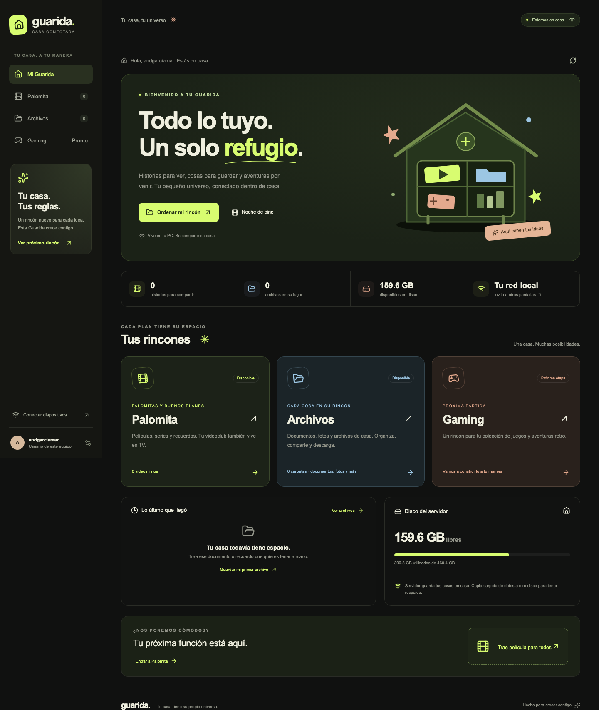

# Guarida 🏡 · Palomita 🍿

**Tu casa tiene su propio universo.** Centro local para cine, documentos y próximas ideas. PC Windows guarda datos; dispositivos de casa comparten biblioteca.

Una PC guarda biblioteca y ejecuta servidor. Desde cualquier ordenador o teléfono de misma red, abre Guarida en navegador para subir, buscar y reproducir. **Android TV usa app nativa **Palomita TV****, instalable mediante APK y USB, con control remoto. Sin nube, anuncios ni suscripciones.



## Qué incluye

- **Inicio Guarida**: secciones, actividad reciente y espacio real de disco.
- **Palomita**: videoclub web y APK Android TV. Carátula incrustada tiene prioridad sobre fotograma automático.
- **Archivos**: carpetas, subir varios documentos/fotos/comprimidos, buscar, renombrar, mover, descargar y eliminar. Hasta 2 GB por archivo, configurable.
- **Gaming**: espacio preparado para próxima etapa; biblioteca de juegos y emulación todavía no implementadas.
- **Subtítulos**: extracción automática de texto incrustado; añadir SRT/VTT UTF-8 desde reproductor web. Pistas compartidas con TV.
- **Reproductor TV**: saltos fijos de 10 segundos, repeticiones de tecla ignoradas, menús de subtítulos/audio, velocidad e imagen; reintento de conexión y posición guardada.

- Catálogo visual, carátulas y vistas previas automáticas, búsqueda, colecciones y ordenamiento.
- Subidas de varios videos con progreso, títulos y nombre de quien los comparte. Hasta 30 GB por archivo, configurable.
- Reproducción con controles nativos, búsqueda de posición, pantalla completa y ventana flotante cuando navegador lo permita.
- Favoritos y “seguir viendo” independientes por navegador/dispositivo.
- Modo TV con tarjetas grandes y navegación con flechas, Enter y Escape.
- App nativa Android TV: detección de PC por Wi-Fi, catálogo con control remoto, favoritos y reproductor Media3/ExoPlayer con posición guardada. Android 6.0 o superior.
- Perfil automático con usuario del sistema al abrir web desde PC servidor; otros navegadores piden nombre una vez. TV detecta nombre de dispositivo y permite guardar nombre de persona.
- Conversión automática a MP4 H.264/AAC para formatos que no reproducen navegadores. FFmpeg y FFprobe se descargan durante instalación.
- Edición de títulos, categorías y descripciones; descarga del original; eliminación con confirmación para toda la casa.
- Código compartido opcional para proteger acceso.
- SQLite y videos almacenados en disco. Funciona sin internet después de instalar.

## Actualizar instalación Windows existente

Lee [actualización Windows y APK](docs/ACTUALIZAR-WINDOWS.md). Mantiene datos, `.env`, tarea de arranque `CasaCine` y paquete Android anteriores. Sitio inicial ahora es `/`; cine está en `/cine`, archivos en `/archivos`.

## Empezar en Windows

1. Instala **Node.js LTS 24 o superior** desde [nodejs.org](https://nodejs.org/).
2. Descarga este repositorio con **Code → Download ZIP**, extrae carpeta en tu PC.
3. Haz doble clic en **`INICIAR-WINDOWS.cmd`**.
4. Primera vez instala dependencias y FFmpeg: necesita internet y puede tardar varios minutos. Después muestra `http://localhost:3210` y direcciones para dispositivos de casa.
5. Abre `http://localhost:3210` en PC servidor. Desde otros equipos, usa dirección que muestra terminal, por ejemplo `http://192.168.1.50:3210`.
6. Sube videos. Espera a que termine preparación; aparecen disponibles para todos.

Si Windows pregunta por firewall, permite Node.js en **redes privadas**. Mantén ventana del servidor abierta y PC encendida, sin suspensión mientras miras videos.

### Si otro equipo no puede entrar

- PC y dispositivo deben estar en mismo router/red. Evita Wi-Fi de invitados y aislamiento de clientes.
- En Windows, configura tu red doméstica como **Privada**.
- Si firewall sigue bloqueando, abre PowerShell **como administrador**, dentro de carpeta del proyecto, y ejecuta:

```powershell
powershell.exe -NoProfile -ExecutionPolicy Bypass -File .\scripts\allow-windows-lan.ps1
```

Reglas permiten puerto HTTP configurado y UDP 3211 para detección de TV, únicamente desde subred local en perfil privado. No abren puertos del router.

### Android TV / Google TV

1. Descarga **Palomita-TV-v1.1.0.apk** desde [Releases de repositorio privado](https://github.com/andress1014/casa-cine/releases). En GitHub necesitas sesión de tu cuenta personal.
2. Copia APK a memoria USB y conéctala a TV. USB transfiere instalador; películas permanecen en PC.
3. Abre gestor de archivos de TV y selecciona APK. Si TV no incluye gestor, instala uno compatible desde Google Play.
4. Cuando Android lo solicite, permite **Instalar apps desconocidas** para ese gestor e instala Palomita TV. Nombre/ruta de ajuste depende de fabricante; [Android documenta permiso por aplicación](https://developer.android.com/studio/publish).
5. Abre **Palomita** desde menú de aplicaciones de TV. Con PC encendida y servidor abierto, app busca servidor Guarida dentro de Wi-Fi.
6. Si detección falla, escribe IP que muestra servidor, por ejemplo `192.168.1.50:3210`. Si configuraste código de casa, app lo pide.
7. Guarda tu nombre para perfil de TV. Flechas exploran, OK reproduce, mantener OK abre detalles/favoritos/iniciar desde cero; controles de reproducción permiten pausar y avanzar/retroceder.

APK 1.1.0 conserva paquete y firma de versión inicial: instálala encima de anterior para mantener favoritos/IP. Nombre visible cambia a **Palomita**. APK es compilación **debug firmada**, apta para instalación personal. No está publicada en Play Store. Si compilas con otra clave, actualizar instalación existente puede requerir desinstalar antes y perder favoritos/historial de TV. App no es WebView; usa controles Android y reproductor nativo. PC debe permanecer encendida y conectada.

Web conserva **Modo TV** como alternativa para pantallas con navegador. No incluye transmisión Chromecast.

### Usuario y nombre por dispositivo

En PC servidor, web obtiene usuario de Windows/macOS/Linux desde proceso que inició Guarida, cuando conexión viene del mismo equipo. No entrega ese usuario a otros equipos de red. Navegadores remotos no pueden leer cuenta de Windows/Mac: piden tu nombre una vez y lo guardan en ese navegador. Nombre se aplica a perfil y autor de subidas; puedes editarlo. Favoritos/historial siguen independientes por dispositivo.

**Nombre automático en otros ordenadores:** abre `ABRIR-CLIENTE-WINDOWS.cmd` desde equipo Windows, o `ABRIR-CLIENTE.command` desde Mac/Linux (requiere Python 3). Escribe IP de servidor. Acceso lee usuario del equipo cliente y abre navegador con perfil correcto; no necesitas instalar Node.js en clientes. Nombre se pasa en fragmento de URL, no se envía en petición inicial ni se guarda en logs HTTP; web lo conserva localmente. Nombre personalizado elegido en perfil tiene prioridad. En Linux puedes ejecutar `sh ABRIR-CLIENTE.command`.

Android TV lee nombre de dispositivo configurado en sistema (o modelo si no está disponible); cuenta de usuario de Android no está expuesta a apps normales. Perfil permite guardar nombre de persona. No lee cuentas Google ni solicita acceso a ellas.

## Instalar desde terminal (Windows, macOS o Linux)

```bash
git clone https://github.com/andress1014/casa-cine.git
cd casa-cine
npm ci
npm run build
npm start
```

Servidor escucha puerto **3210** en interfaces IPv4 (`0.0.0.0`) y rechaza conexiones cuya IP no sea privada/local. Solo navegador usa servidor: equipos clientes no necesitan Node.js ni Git.

Para desarrollo, `npm run dev` sirve React y API desde mismo puerto con recarga automática.

## Configuración y almacenamiento

Copia `.env.example` a `.env` (script Windows lo hace automáticamente). Reinicia después de cambiarlo.

| Variable | Valor inicial | Uso |
| --- | --- | --- |
| `PORT` | `3210` | Puerto de interfaz y API. |
| `HOST` | `0.0.0.0` | Interfaces IPv4 de PC; `127.0.0.1` restringe a PC. |
| `DATA_DIR` | `./data` | Carpeta absoluta alternativa, por ejemplo `D:\GuaridaData`. |
| `MAX_UPLOAD_GB` | `30` | Límite por video. |
| `MAX_FILE_UPLOAD_GB` | `2` | Límite por documento, foto o comprimido. |
| `HOUSE_CODE` | vacío | Código compartido opcional; todos lo introducen para entrar. |
| `FFMPEG_PATH` / `FFPROBE_PATH` | binarios incluidos | Sustituir FFmpeg/FFprobe por instalación propia. |
| `DISCOVERY` | activado | `off` desactiva búsqueda automática de TV por UDP 3211. |

Para proteger acceso: configura `HOUSE_CODE` con una frase difícil de adivinar. Sesión dura 30 días; reiniciar servidor pide código de nuevo. HTTP está pensado para red doméstica de confianza. No uses esta configuración para publicar servicio en internet.

Archivos originales quedan en `data/originals`; conversiones en `data/prepared`; miniaturas en `data/posters`; catálogo de cine en `data/library.sqlite`; documentos en `data/documents`, carpetas/catálogo de archivos en `data/home.sqlite`; subtítulos en `data/subtitles`. Código GitHub excluye toda carpeta `data` y `.env`: **videos nunca se suben a GitHub**. Para respaldo, detén servidor y copia carpeta de datos completa. Historial/favoritos están en almacenamiento del navegador y no forman parte de respaldo del servidor.

## Formatos, conversión y espacio

- Admite MP4, M4V, MOV, WebM, MKV, AVI, MPEG/MPG, WMV y TS, siempre que FFprobe reconozca un video válido.
- MP4/M4V con H.264 y AAC/MP3 se reproducen desde original.
- H.264 en otro contenedor se empaqueta como MP4 sin recomprimir imagen; audio se convierte a AAC.
- Otros códecs se convierten a H.264/AAC, máximo 1920 píxeles de ancho. Original conserva calidad original.
- Conversión procesa un video a la vez para no saturar PC. Un archivo largo puede tardar bastante: no hay reproducción hasta terminar preparación.
- Original y copia preparada pueden ocupar bastante más que tamaño del archivo subido. Reserva espacio adicional; servidor comprueba espacio para subida, pero conversión también necesita espacio.
- Todas pistas de audio se conservan en preparación (AAC). TV permite escoger idioma. Subtítulos de texto incrustados se extraen a VTT; también admite subir SRT/VTT UTF-8 hasta 5 MB. ASS/SSA se convierten a texto básico; PGS/VobSub (imágenes) requieren añadir SRT/VTT. No hay OCR ni descarga automática de subtítulos.
- FFmpeg limita acceso a protocolos de archivos/pipe; no obtiene contenidos de internet.
- Cerrar servidor cancela conversión actual y la retoma desde principio al siguiente arranque. Subida interrumpida debe volver a intentarse.
- Cada dispositivo reproduce independiente; esta versión no sincroniza sesiones entre pantallas.

## Docker (opcional)

```bash
docker compose up --build -d
```

Por defecto Docker publica en `127.0.0.1:3210`. Para casa, define `CASACINE_BIND_IP` con IP LAN de máquina en `.env`, por ejemplo `CASACINE_BIND_IP=192.168.1.50`. TV con Docker requiere introducir IP manualmente: compose no publica UDP de descubrimiento. Volumen `casacine-data` conserva biblioteca. No ejecutes `docker compose down -v` si quieres conservar videos. Identidad automática del servidor dentro de contenedor corresponde a usuario de contenedor; usa perfil manual si ejecutas con Docker.

## Compilar app Android TV

Requisitos: JDK 17, Android SDK con plataforma 36 y build tools 35.0.0. [Media3](https://developer.android.com/jetpack/androidx/releases/media3) provee reproductor. Gradle Wrapper descarga Gradle 8.13 con checksum verificado.

```powershell
cd android-tv
.\gradlew.bat :app:assembleDebug
```

macOS/Linux: `cd android-tv && ./gradlew :app:assembleDebug`. Configura `ANDROID_HOME` o `android-tv/local.properties` con `sdk.dir=...`. APK aparece en `android-tv/app/build/outputs/apk/debug/app-debug.apk`.

Claves de firma y SDK no se versionan. App guarda código de casa/cookie en memoria, nunca en preferencias ni logs; nombre, servidor, favoritos y posición son locales a TV. Historial web y TV no se sincronizan.

## Verificación

```bash
npm run check
npx playwright install chromium
npm run test:ui
cd android-tv
./gradlew :app:testDebugUnitTest :app:lintDebug :app:assembleDebug
```

Pruebas cubren carátulas incrustadas, subtítulos, varias pistas de audio, biblioteca de documentos y archivos reales generados con FFmpeg: subida, preparación, MKV/AVI, lectura por rangos, edición, persistencia, autenticación y rechazos de entradas inválidas. Navegador cubre Inicio/Archivos/Gaming, vista móvil, carpetas, subidas, reproducción, selección de subtítulos y favoritos. Android incluye JUnit + Robolectric para barra de película larga, eventos del control, repetición, pausa, regreso y URLs de pistas. No se incluyen películas de muestra ni contenido de terceros.

Tecnología: React + TypeScript + Vite; Express; SQLite integrado de Node.js; FFmpeg/FFprobe. Requisitos: Node.js 24+ y espacio en disco. Windows: x64; binarios npm FFmpeg no incluyen Windows ARM64 nativo.

Plantilla opcional de GitHub Actions: [docs/ci-template.yml](docs/ci-template.yml). Copiar a `.github/workflows/ci.yml` activa CI; publicación con token OAuth requiere permiso `workflow`. Plantilla permanece desactivada por defecto. Windows físico y tu modelo de Android TV todavía requieren comprobación en casa.

Más detalles: [arquitectura](docs/architecture.md), [investigación y controles de TV](docs/TV-PLAYER.md), [agregar secciones](docs/MODULOS.md).
