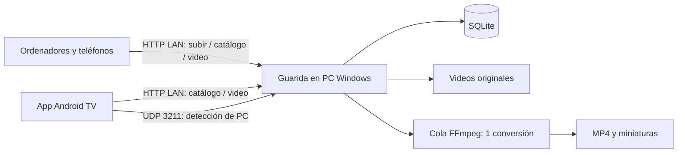

# Arquitectura y alcance

## Decisión

Aplicación doméstica con servidor único en PC Windows, clientes web para subir/reproducir y app nativa Android TV para control remoto. Código privado en cuenta personal; contenido permanece en disco local. Dependencias públicas, sin SDKs ni servicios corporativos. No hay catálogo externo ni metadatos remotos.

## Flujos

POST multipart guarda video en disco temporal, valida metadatos con Zod y verifica contenido con FFprobe. Genera UUID aleatorio, mueve archivo a carpeta de originales y persiste catálogo. Conversión ocurre en segundo plano. Hasta cuatro subidas simultáneas; cada navegador envía su selección secuencialmente.

Estados: `processing → ready` o `processing → error`. Solo archivos listos ofrecen stream. Original se puede descargar en cualquier estado. Reintento explícito permite `error → processing`. Inicio recupera conversiones pendientes y limpia temporales de subidas interrumpidas. Se debe ejecutar una sola instancia por carpeta de datos.

Reproducción usa respuestas HTTP con soporte Range, necesarias para buscar posición sin descargar archivo completo. Express transmite desde disco. No carga videos completos en RAM.

Favoritos, nombre e historial son locales al navegador o TV. Usuario de proceso servidor se entrega por `/api/device` únicamente a conexiones cuyo origen sea propio equipo. Otros navegadores requieren nombre elegido. Android TV obtiene nombre de dispositivo mediante ajustes/modelo y perfil elegido; no accede a cuentas Google. Títulos, categorías, descripciones y archivos pertenecen a biblioteca compartida. Eliminación afecta a todos; web exige confirmación. Sin roles.

TV implementa Activity/GridView nativos y PlayerView/ExoPlayer de AndroidX Media3. Valida IP privada literal, puerto y UUID antes de construir URLs; no acepta direcciones de servidor desde intents externos, rutas arbitrarias ni DNS. PlayerActivity no está exportada. Catálogo usa HTTP sin redirecciones; cookies de código compartido permanecen en memoria. Preferencias privadas contienen nombre, IP, favoritos y progreso; backup Android está desactivado.

UDP responde mensaje fijo de descubrimiento únicamente a IP local. Anuncia app, versión de protocolo y puerto HTTP; no anuncia usuario, contraseña ni biblioteca. Si broadcast/firewall falla, conexión por IP manual continúa funcionando. Permiso INTERNET habilita HTTP en LAN y UDP; conexión local es HTTP como web.

## Controles revisados

- Solo acepta IPs privadas, loopback o link-local. No confía en `X-Forwarded-For`.
- Valida Host para bloquear rebinding y Origin / Sec-Fetch-Site para impedir solicitudes de otros sitios.
- Código de casa opcional; cookie HttpOnly/SameSite Strict firmada con secreto aleatorio en memoria; intentos fallidos limitados.
- Zod valida metadatos y UUIDs; extensión, MIME y contenido de video se verifican.
- Archivos se guardan con UUID servidor, nunca con ruta enviada por cliente.
- Consultas SQLite parametrizadas; React escapa contenido; sin HTML arbitrario.
- FFmpeg se invoca con argumentos separados y sin shell, rutas generadas, sin protocolos de red.
- API usa errores públicos sin rutas internas ni stack traces.
- CSP local limita contenido a propio servidor; interfaz no descarga fuentes, imágenes ni scripts externos.
- Datos privados, archivos y variables de entorno excluidos de Git.

Patrones considerados: CWE-22, CWE-78, CWE-89, CWE-79, CWE-352, CWE-209, CWE-338. Revisión adaptada a aplicación personal: recomendaciones de SDKs MeLi/Fury no aplican a este repositorio.

## Límites conocidos

No es servidor público. NAT/VPN/reverse proxy puede hacer que IP remota parezca local; evitar reenviar puertos o publicarlo. No existe aislamiento entre usuarios de casa ni cifrado HTTP. Usa código de casa si compartes Wi-Fi con invitados.

Videos largos pueden tardar en convertir. Espacio de conversiones requiere margen adicional, no una cuota global. Subidas interrumpidas no son reanudables. Una sola instancia maneja biblioteca; no desplegar varios procesos contra mismo directorio.

No se ha verificado en hardware Android TV ni Windows físico durante desarrollo en macOS. APK debug sirve para instalación personal mediante USB, no distribución Play Store. Compatibilidad final de decodificación depende de TV y video; servidor prepara MP4 H.264/AAC. No incluye Cast, HLS, sincronización, importación de carpetas existentes sin copia ni cuentas múltiples.

## Evolución 1.1.0

Guarida contiene secciones declaradas en `shared/home-modules.json`. Rutas web independientes: inicio `/`, Palomita `/cine`, Archivos `/archivos`, Gaming `/gaming` (planificado). Conserva `/api/media`, identidad y contrato UDP para APK anterior.

Archivos usa SQLite separado `home.sqlite`: carpetas anidadas y archivos UUID, originales en `documents`. Subida multipart transmite a disco; valida extensión, MIME, firma básica, metadatos y límite; SHA-256 calcula huella sin cargar archivo completo. Descargas como adjunto, nunca ejecución ni extracción de comprimidos. Sincroniza listas con sondeo local.

Catálogo de cine agrega columnas mediante migración aditiva. Cola serial extrae carátula incrustada y subtítulos de texto desde originales; transforma SRT/VTT externos con FFmpeg limitado a protocolos locales. Pistas tienen UUID, idioma y etiqueta; API mantiene autenticación común. Solo permite modificar pistas externas. Lectura de imágenes y subtítulos tiene límites; no se aceptan URLs externas. Preparación mantiene varios audios. Refrescar metadata de videos antiguos puede recuperar audios perdidos en preparación anterior copiando video sin recodificar.

Estado privado de app TV mantiene namespace/paquete anteriores; nombre visible cambia a Palomita. PlayerView usa incremento de tiempo fijo y despacho único de control; navegación, selección de pistas, tamaño de imagen, velocidad y reintento son nativos.
